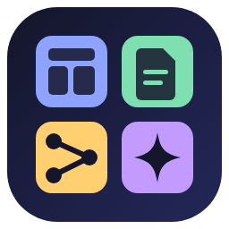
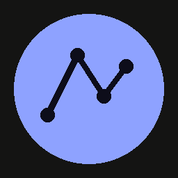
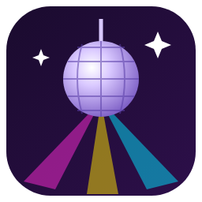
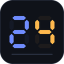
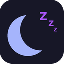

<div align="center">

# 🏠 Pi Custom Features

**12 Home Assistant add-ons for building, partying, tracking and talking to your home, all with pages that match your theme.**

[](https://github.com/jonathangibson98/pi-custom-features/actions/workflows/validate.yml)
[](https://github.com/jonathangibson98/pi-custom-features/actions/workflows/publish-ghcr.yml)
[](LICENSE)


[](https://github.com/jonathangibson98?tab=packages)
[](https://github.com/jonathangibson98/pi-custom-features/commits/main)
[](https://github.com/jonathangibson98/pi-custom-features/issues)


[](https://my.home-assistant.io/redirect/supervisor_add_addon_repository/?repository_url=https%3A%2F%2Fgithub.com%2Fjonathangibson98%2Fpi-custom-features)

</div>

---

## Contents

- [Add-ons](#add-ons)
- [Install](#install)
- [What each add-on needs](#what-each-add-on-needs)
- [Features in every add-on](#features-in-every-add-on)
- [Back up every add-on at once](#back-up-every-add-on-at-once)
- [Run without Home Assistant](#run-without-home-assistant)
- [Troubleshooting](#troubleshooting)
- [Development](#development)
- [License](#license)

## Add-ons

### Build & create

| | Add-on | Version | What it does |
|:---:|---|:---:|---|
|  | **[Creator & AI Builder](ai_builder/)**<br><sub>[docs](ai_builder/DOCS.md) · [changelog](ai_builder/CHANGELOG.md)</sub> |  | Describe what you want in plain English and your Home Assistant AI builds it: automations, scripts, scenes, helpers, template sensors, dashboards and cards. Also voice announcements, dashboard facts, text-file sensors and backups. |
|  | **[Photo Hub](photo_shuffle/)**<br><sub>[docs](photo_shuffle/DOCS.md) · [changelog](photo_shuffle/CHANGELOG.md)</sub> |  | Everything photos in one place: folder shuffles and Unsplash collections as image entities, one wallpaper for every add-on page, a Photo Editor with AI tools, and SVG Maker. |
|  | **[Zone Creator](zone_creator/)**<br><sub>[docs](zone_creator/DOCS.md) · [changelog](zone_creator/CHANGELOG.md)</sub> |  | Search an address, drop a pin and create a Home Assistant zone, with optional AI name and icon suggestions. |
|  | **[SVG Maker](svg_maker/)**<br><sub>[docs](svg_maker/DOCS.md) · [changelog](svg_maker/CHANGELOG.md)</sub> |  | Turn photos into clean, scalable SVG icons. **Moved into Photo Hub**: this stand-alone add-on still works but gets no new features. |

### Fun & media

| | Add-on | Version | What it does |
|:---:|---|:---:|---|
|  | **[Party Lights](party_lights/)**<br><sub>[docs](party_lights/DOCS.md) · [changelog](party_lights/CHANGELOG.md)</sub> |  | Music-synced lights, 25 light modes, color themes and 20+ party games, run from a phone-friendly page, a dashboard dropdown, an automation or MQTT. |

### Voice & AI

| | Add-on | Version | What it does |
|:---:|---|:---:|---|
|  | **[Voice Chat](voice_chat/)**<br><sub>[docs](voice_chat/DOCS.md) · [changelog](voice_chat/CHANGELOG.md)</sub> |  | Hands-free voice conversation with any Home Assistant conversation agent, answered out loud on the speakers you choose. |
|  | **[Personal AI Speech](personal_ai_speech/)**<br><sub>[docs](personal_ai_speech/DOCS.md) · [changelog](personal_ai_speech/CHANGELOG.md)</sub> |  | Natural text-to-speech with emotion tags and local speech-to-text, as an OpenAI-compatible server for the Personal AI integration. |

### System

| | Add-on | Version | What it does |
|:---:|---|:---:|---|
|  | **[Pi Health Monitor](pi_health_monitor/)**<br><sub>[docs](pi_health_monitor/DOCS.md) · [changelog](pi_health_monitor/CHANGELOG.md)</sub> |  | A lightweight health check for the machine Home Assistant runs on, with plain-English fixes. |

### Tracking

| | Add-on | Version | What it does |
|:---:|---|:---:|---|
|  | **[Release Tracker](release_tracker/)**<br><sub>[docs](release_tracker/DOCS.md) · [changelog](release_tracker/CHANGELOG.md)</sub> |  | Track anything with a release date and get told when it drops: shows, movies, games and DLC, albums, celebrities, tech, merch and events. |
|  | **[Team Tracker Lite](team_tracker_lite/)**<br><sub>[docs](team_tracker_lite/DOCS.md) · [changelog](team_tracker_lite/CHANGELOG.md)</sub> |  | One lightweight sports sensor: pick any team from a menu and switch whenever you like. |
|  | **[Sleep Tracker](sleep_tracker/)**<br><sub>[docs](sleep_tracker/DOCS.md) · [changelog](sleep_tracker/CHANGELOG.md)</sub> |  | Knows who's asleep by checking several signals at once (phone, Focus, lights, TV, motion), with MQTT sensors and sleep history. |
|  | **[Work Hours Tracker](work_hours/)**<br><sub>[docs](work_hours/DOCS.md) · [changelog](work_hours/CHANGELOG.md)</sub> |  | Logs the time people spend in chosen zones, one file per person, with MQTT sensors and pay periods. |

<details>
<summary><b>Feature lists for every add-on</b> (tap to open)</summary>

#### Creator & AI Builder

- **Build**: automations, scripts, scenes, helpers, template sensors, blueprints and more from a plain-English request, checked before anything is saved
- **Dashboards**: open any dashboard, ask for changes and see a live preview drawn with your real cards and theme at your screen's exact size (cast TV, Nest Hub, tablet, phone, or **My screens** read from Browser Mod sensors)
- **Does it fit?** measures the real page and **Make it fit** sends the overflow to the AI. Every save keeps the version before it
- **Cards**: make and edit single cards with a preview
- **Voice & facts**: AI announcements on a schedule or a dashboard switch, and rotating facts saved to sensors
- **Files** (formerly File Reader): text files as sensors over MQTT, updated from automations or the REST API
- **Backup**: one-click and scheduled backups of everything the add-on made

#### Photo Hub

- **Folders** and **Unsplash** collections published as `image` entities over MQTT, shuffled on a timer
- **Wallpaper**: one background for every add-on page in this repository, with darken, lighten and blur
- **Photo Editor**: crop, adjust, filters and AI edits through your `ai_task` entity
- **SVG Maker**: trace photos into clean SVG icons, or have the AI draw a logo
- Pictures move between tabs in one tap (edit a shuffle photo, set it as wallpaper, trace it as an icon)
- Resizes images for dashboards (default 1920 px, JPEG quality 85)

#### Party Lights

- **Music sync**: lights take their colors from the album art, plus an album-art brightness/color sensor for dashboards
- **25 light modes**: disco, chase, comet, ping pong, heartbeat, aurora, ocean, fireworks, lava lamp, shuffle and more
- **Color themes**: holidays, album art, team colors, your own, or AI colors from a description
- **20+ games**: freeze dance, red light green light, trivia, truth or dare, never have I ever, name that tune, power hour, shot caller, last call, light roulette, hot potato, dance battle…
- **Control it from anywhere**: a mode dropdown made for you, `hassio.addon_stdin`, or 8 simple MQTT entities (party, mode, colors, brightness, speed, game, quick hit, status)
- **Music sync checklist** shows exactly why the lights are or aren't following the music
- iPhone-first page with a bottom tab bar and pull-up settings sheets
- Lights are put back the way they were when the party ends

#### Voice Chat

- Talk from any phone or browser; the reply plays on one or several speakers, or in the browser
- Works with any conversation agent (Assist, OpenAI, Google, Ollama, Personal AI…), switchable on the page
- Hands-free mode with silence detection
- Household info and live entity values given to the AI as context
- Runs as an add-on or as a plain Docker container

#### Personal AI Speech

- Local **Kokoro** text-to-speech with `[happy]`, `[whisper]`, `[sad]`… emotion tags
- Local **faster-whisper** speech-to-text
- OpenAI-compatible `/v1/audio/speech` and `/v1/audio/transcriptions` on port 8880
- Optional proxy to OpenAI or another compatible server
- Test page in the sidebar

#### Pi Health Monitor

- CPU, temperature, memory, disk, load and uptime, refreshed every 5 seconds
- Raspberry Pi under-voltage and throttling, now and since boot
- Per add-on CPU and RAM (or per container when run in Docker)
- Health checks: storage wear, updates, backups, repairs, log errors and unavailable entities
- **Database**: which entities fill your recorder database the most
- AI fix tips through your `ai_task` entity
- Runs as an add-on or as a plain Docker container

#### Release Tracker

- TV and movies (TMDB), games and DLC (IGDB), music (MusicBrainz), celebrities, and anything else you type in
- Per-person lists, so each household member follows their own things
- One sensor (`sensor.release_tracker_releases`) with every upcoming release as attributes, for dashboards and automations
- Notifications when something drops, to everyone or one person
- AI help to fill in dates and details

#### Team Tracker Lite

- Any team from ESPN's leagues, chosen in the sidebar panel
- One sensor (`sensor.team_tracker`) with game state, score, teams and colors
- Live game: follow any game that's on right now
- Optional calendar feed on port 8100 for your phone
- **Score lights**: flash lights in the team's colors when they score

#### Sleep Tracker

- Suggests signals for each person and their bedroom automatically
- Only calls it when enough signals agree for long enough
- Asleep sensors and sleep/wake times over MQTT
- Last night's sleep, a 7-night average, naps and interruptions as sensors, plus sleep history
- AI help to tune the signals

#### Work Hours Tracker

- Pick people and their work zones in the sidebar
- Each person gets their own pay period (one or two weeks, starting any day)
- Hours in the current pay period as sensors over MQTT
- One CSV per person (default `/homeassistant/work_hours`, kept 365 days)
- Grace time so a quick trip out doesn't split the day, and a minimum visit length

#### Zone Creator

- Searches three free geocoders at once (US Census, OpenStreetMap, Photon)
- Paste coordinates, drag the pin and set the radius on the map
- AI name and icon suggestions through your `ai_task` entity
- Zones appear immediately in Home Assistant

#### SVG Maker

- Auto crop (circle, rounded, square or full) and auto-enhance
- Color or black-and-white tracing (vtracer)
- AI logos through your `ai_task` entity
- Icons saved to `/homeassistant/custom_icons` with icon-friendly names

</details>

## Install

1. Click **Add this repository** above, or in Home Assistant go to **Settings → Add-ons → Add-on Store → ⋮ → Repositories** and add:

   ```text
   https://github.com/jonathangibson98/pi-custom-features
   ```

2. Refresh the store (**⋮ → Check for updates**). The add-ons show up under **HA Custom Features**.
3. Open one, click **Install**, look over its **Configuration** tab, then **Start**. Turn on **Show in sidebar** to open its page from the sidebar.
4. Every add-on has a **Documentation** tab (its `DOCS.md`) with setup steps, examples and every option.

> [!NOTE]
> Add-ons need Home Assistant OS or a Supervised install. Most download a prebuilt image from GitHub's container registry, so installs and updates are quick even on a Raspberry Pi. Release Tracker and Sleep Tracker build on your device the first time.

## What each add-on needs

| Add-on | MQTT | AI Task | Extra port | Prebuilt image | Also runs in Docker |
|---|:---:|:---:|:---:|:---:|:---:|
| [Creator & AI Builder](ai_builder/) | optional | ✨ | 8100 | ✅ | — |
| [Photo Hub](photo_shuffle/) | optional | ✨ | — | ✅ | — |
| [Party Lights](party_lights/) | optional | ✨ | — | ✅ | — |
| [Voice Chat](voice_chat/) | — | — | 8443 | ✅ | ✅ |
| [Personal AI Speech](personal_ai_speech/) | — | — | 8880 | ✅ | — |
| [Pi Health Monitor](pi_health_monitor/) | — | ✨ | — | ✅ | ✅ |
| [Release Tracker](release_tracker/) | optional | ✨ | — | — | — |
| [Team Tracker Lite](team_tracker_lite/) | optional | ✨ | 8100 | ✅ | — |
| [Sleep Tracker](sleep_tracker/) | optional | ✨ | — | — | — |
| [Work Hours Tracker](work_hours/) | optional | ✨ | — | ✅ | — |
| [Zone Creator](zone_creator/) | — | ✨ | — | ✅ | — |
| [SVG Maker](svg_maker/) | — | — | — | ✅ | — |

- **MQTT**: the [Mosquitto broker](https://github.com/home-assistant/addons/tree/master/mosquitto) add-on is found automatically. Using your own broker? Fill in the `mqtt_*` options. "Optional" add-ons still work without it but don't make entities.
- **AI Task** ✨: any integration that offers an `ai_task` entity (Google Gemini, OpenAI, Anthropic, Ollama, Personal AI…). AI buttons use the add-on's `ai_task_entity` option; if that's empty they use the household default AI (`select.default_ai_task`, set in the Personalized Info add-on), then the first AI Task found.

## Features in every add-on

**Pages that match your theme.** Every page reads your active Home Assistant theme (colors, light or dark mode, wallpaper, glass blur, card corners) and follows it live. Over a wallpaper it checks how bright the picture is and tints behind text just enough to keep it readable. Outside Home Assistant the pages keep their own look.

**One wallpaper for all of them.** Pick it in **Photo Hub → Wallpaper** (upload, choose a photo, or follow a shuffle or Unsplash collection). Each add-on's own `wallpaper` option wins over that: empty uses your theme's wallpaper, `none` turns it off, or give an image in `/config/www` (`pic.jpg` or `/local/pic.jpg`) or an `https://` link.

**Backups built in.** Every add-on that keeps data has a **Backups** page (back up now, download, restore, restore from a file) and `backup_path`, `backup_every` and `backup_keep` options (default `/share/addon_backups/<slug>`, daily, keep 10). Creator & AI Builder and Release Tracker have their own backup pages. Backups include the Configuration tab, so keep the folder private.

**Commands from automations.** Most add-ons take commands sent with Home Assistant's `hassio.addon_stdin` action, for example `backup` (every add-on with backups) or `disco`, `off`, `party on` and `game trivia on` (Party Lights).

## Back up every add-on at once

Every add-on with backups listens for `backup` on `hassio.addon_stdin`. Add this script under **Settings → Automations & scenes → Scripts → Create script → ⋮ → Edit in YAML**, then run it from a dashboard button or an automation:

```yaml
alias: Back up all add-ons
description: Tells each custom add-on to save a backup to the folder set on its Configuration tab.
icon: mdi:backup-restore
mode: single
sequence:
  - repeat:
      for_each:
        - ai_builder
        - release_tracker
        - sleep_tracker
        - work_hours
        - photo_shuffle
        - voice_chat
        - team_tracker_lite
        - svg_maker
        - zone_creator
        - personal_ai_speech
      sequence:
        - action: hassio.addon_stdin
          continue_on_error: true
          data:
            addon: "e15fb2fe_{{ repeat.item }}"
            input: backup
  - action: persistent_notification.create
    data:
      title: Add-on backups
      message: Every add-on was asked to back up. Each saves to the backup folder on its Configuration tab.
```

`e15fb2fe` is the prefix Home Assistant gives this repository. To check yours, open any of these add-ons and look at the end of the page address (for example `.../e15fb2fe_sleep_tracker/info`). Add-ons that aren't installed or running are skipped.

## Run without Home Assistant

Two add-ons also run as a plain Docker container from the same code.

### Pi Health Monitor

| | Home Assistant add-on | Docker / docker compose |
|---|---|---|
| Detected by | `SUPERVISOR_TOKEN` is present | no `SUPERVISOR_TOKEN` |
| Table shows | HA Core, Supervisor, started add-ons | running Docker containers |
| Stats from | the Supervisor API | the Docker Engine API |
| Built from | `pi_health_monitor/Dockerfile` | `pi_health_monitor/Dockerfile.standalone` |

```bash
cd pi_health_monitor
docker compose up -d --build      # or: docker compose pull && docker compose up -d
```

Open `http://<host>:8099`.

| Variable | Default | Purpose |
|---|---|---|
| `PORT` | `8099` | Port the dashboard listens on inside the container |
| `DOCKER_HOST` | `unix:///var/run/docker.sock` | Docker API endpoint, also `tcp://host:port` |
| `DISK_PATH` | `/` | Path used for the Disk card. Mount the host root at `/hostfs:ro` and set this to `/hostfs` to show the real host disk |

> [!WARNING]
> The standalone dashboard has no login. Keep the port on your LAN or put it behind a reverse proxy with authentication. Mounting `docker.sock` read-only still allows the full Docker API; the commented `docker-socket-proxy` service in `pi_health_monitor/docker-compose.yml` limits it to read-only container endpoints.

Host CPU, memory, load, uptime, temperature and Raspberry Pi throttling come from `/proc` and `/sys`, so they show the host's values. Per-container CPU is a share of the whole host, on the same scale as the CPU card.

### Voice Chat

| | Home Assistant add-on | Docker / docker compose |
|---|---|---|
| Talks to Home Assistant with | the Supervisor token | `HA_URL` + a long-lived access token `HA_TOKEN` |
| Settings from | the Configuration tab | `VC_*` variables in `.env` |
| Password | optional (only for the direct HTTPS page) | always required (generated if you don't set one) |
| Built from | `voice_chat/Dockerfile` | `voice_chat/Dockerfile.standalone` |

```bash
cd voice_chat
cp .env.example .env        # set HA_URL, HA_TOKEN and your entity IDs
docker compose up -d --build
```

Open `https://<this-machine>:8443`, accept the certificate warning once and enter the password (from `VC_PASSWORD`, or the generated one in `docker compose logs voice-chat` and `./data/password.txt`). Browsers only allow the microphone on secure pages, which is why it uses HTTPS.

## Troubleshooting

| Problem | Fix |
|---|---|
| The add-ons don't show in the store | **⋮ → Check for updates** in the Add-on Store, then refresh the page. Check the repository URL has no trailing slash or `.git`. |
| Install fails with `pull access denied` or `manifest unknown` | The image for that version is still building (a few minutes after a release) or its package isn't public yet. Try again shortly. |
| An update isn't offered | Home Assistant checks the store a few times a day. **⋮ → Check for updates** forces it. |
| No MQTT entities | Install and start the Mosquitto broker add-on and the MQTT integration, or fill in the add-on's `mqtt_*` options. Then restart the add-on. |
| ✨ AI buttons say no AI is set up | Add an AI integration with an AI Task entity, or set `ai_task_entity` on the add-on's Configuration tab. |
| A page is blank or says "ingress only" | Open it from the sidebar or **Open Web UI**. Pages that change your setup only work through Home Assistant. |
| Something else | Check the add-on's **Log** tab, then [open an issue](https://github.com/jonathangibson98/pi-custom-features/issues) with the add-on version and the log. |

## Development

```text
pi-custom-features/
├── .github/
│   ├── workflows/
│   │   ├── validate.yml        lint, build and sanity checks on every push and pull request
│   │   └── publish-ghcr.yml    builds and publishes the prebuilt images
│   ├── docsgen/                regenerates the READMEs and the generated parts of DOCS.md
│   └── dependabot.yml
├── .shared/                    code every add-on carries a copy of
│   ├── ha-theme.js             theme and wallpaper bridge for the pages
│   ├── ha_ai.py                AI Task helper (picks the default AI)
│   ├── addon_backup.py         the Backups page and scheduled backups
│   ├── sync.sh                 copies the shared files into every add-on
│   └── sync_theme.py           injects ha-theme.js into every page
├── ai_builder/                 Creator & AI Builder
├── party_lights/               Party Lights
├── personal_ai_speech/         Personal AI Speech
├── photo_shuffle/              Photo Hub
├── pi_health_monitor/          Pi Health Monitor + standalone Docker
├── release_tracker/            Release Tracker
├── sleep_tracker/              Sleep Tracker
├── svg_maker/                  SVG Maker
├── team_tracker_lite/          Team Tracker Lite
├── voice_chat/                 Voice Chat + standalone Docker
├── work_hours/                 Work Hours Tracker
├── zone_creator/               Zone Creator
├── repository.yaml             makes this repo addable in the Add-on Store
├── LICENSE
└── README.md
```

Every add-on folder has at least `config.yaml`, `Dockerfile`, `DOCS.md`, `README.md`, `CHANGELOG.md`, `icon.png` and `logo.png`, and `translations/en.yaml` for the option names. Add-on folders have to stay at the top level for Home Assistant to find them.

### Shared code

Each add-on builds from its own folder, so each carries its own copy of the shared files. Edit the file in `.shared/`, then run `.shared/sync.sh` from the repository root to copy it everywhere. To add the theme bridge to a new page: `python3 .shared/sync_theme.py path/to/page.html`.

### Docs

`python3 .github/docsgen/gen.py` rewrites every add-on's `README.md` and the generated blocks of its `DOCS.md` (header, configuration reference, footer) from `config.yaml`, `translations/en.yaml` and `.github/docsgen/meta.py`. `python3 .github/docsgen/root.py` rewrites this README. Edit the hand-written parts of `DOCS.md` outside the `<!-- docs:... -->` markers.

### Releasing

1. Make the change, bump `version` in the add-on's `config.yaml` and add a `CHANGELOG.md` entry.
2. Run the docs generators if options or features changed.
3. Push to `main` (or merge a pull request). **Validate** checks the structure, runs the Home Assistant add-on linter, Hadolint, yamllint and a Python syntax check, and builds every image. **Publish images** then pushes:

| Image | For | Tags |
|---|---|---|
| `ghcr.io/jonathangibson98/<arch>-addon-<slug>` (`aarch64`, `amd64`) | the add-on | the add-on version, `latest` |
| `ghcr.io/jonathangibson98/pi-health-monitor` | standalone Docker | `latest`, the version, a short commit SHA |
| `ghcr.io/jonathangibson98/voice-chat` | standalone Docker | `latest`, the version, a short commit SHA |

A new package is private on GHCR at first: open it under your GitHub profile's **Packages**, then **Package settings**, and make it **Public** so Home Assistant can pull it. If a build fails with `Failed building wheel for ...`, pin the Dockerfile's base image to a released Python (for example `python:3.12-slim-bookworm`).

## License

[MIT](LICENSE). Not affiliated with or endorsed by Home Assistant or Nabu Casa.
