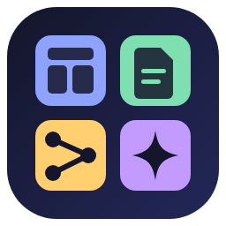

# Creator & AI Builder

     

Describe what you want in plain English and your Home Assistant AI builds it: automations, scripts, scenes, helpers, template sensors, dashboards and cards. Also voice announcements, dashboard facts, text-file sensors and backups.

## Features

- **Build**: automations, scripts, scenes, helpers, template sensors, blueprints and more from a plain-English request, checked before anything is saved
- **Dashboards**: open any dashboard, ask for changes and see a live preview drawn with your real cards and theme at your screen's exact size (cast TV, Nest Hub, tablet, phone, or **My screens** read from Browser Mod sensors)
- **Does it fit?** measures the real page and **Make it fit** sends the overflow to the AI. Every save keeps the version before it
- **Cards**: make and edit single cards with a preview
- **Voice & facts**: AI announcements on a schedule or a dashboard switch, and rotating facts saved to sensors
- **Files** (formerly File Reader): text files as sensors over MQTT, updated from automations or the REST API
- **Backup**: one-click and scheduled backups of everything the add-on made

## What you need

- Home Assistant OS or Supervised (add-ons need the Supervisor)
- An `ai_task` entity (any AI integration that offers AI Task)
- MQTT (optional, for Files sensors)

## Install

1. Click the button above, or go to **Settings → Add-ons → Add-on Store → ⋮ → Repositories** and add `https://github.com/jonathangibson98/pi-custom-features`.
2. Find **Creator & AI Builder** in the store and click **Install**.
3. Check the **Configuration** tab, then **Start**. Turn on **Show in sidebar** to open it from the sidebar.

## Documentation

- [Full documentation](DOCS.md), also on the add-on's **Documentation** tab
- [Changelog](CHANGELOG.md)
- [All add-ons in this repository](../README.md)
