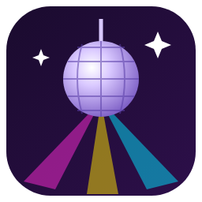

# Party Lights

     

Music-synced lights, 25 light modes, color themes and 20+ party games, run from a phone-friendly page, a dashboard dropdown, an automation or MQTT.

## Features

- **Music sync**: lights take their colors from the album art, plus an album-art brightness/color sensor for dashboards
- **25 light modes**: disco, chase, comet, ping pong, heartbeat, aurora, ocean, fireworks, lava lamp, shuffle and more
- **Color themes**: holidays, album art, team colors, your own, or AI colors from a description
- **20+ games**: freeze dance, red light green light, trivia, truth or dare, never have I ever, name that tune, power hour, shot caller, last call, light roulette, hot potato, dance battle…
- **Sports mode in the same dropdown**: pick *Sports* and Team Tracker Lite's score lights take over the lights; pick anything else and the party is back
- **Control it from anywhere**: a mode dropdown made for you, `hassio.addon_stdin`, or 8 simple MQTT entities (party, mode, colors, brightness, speed, game, quick hit, status)
- **Music sync checklist** shows exactly why the lights are or aren't following the music
- iPhone-first page with a bottom tab bar and pull-up settings sheets
- Lights are put back the way they were when the party ends

## What you need

- Home Assistant OS or Supervised (add-ons need the Supervisor)
- Color lights
- A TTS engine and speakers (optional, for announcements)
- MQTT (optional, for the Home Assistant entities)
- An `ai_task` entity (optional)

## Install

1. Click the button above, or go to **Settings → Add-ons → Add-on Store → ⋮ → Repositories** and add `https://github.com/jonathangibson98/pi-custom-features`.
2. Find **Party Lights** in the store and click **Install**.
3. Check the **Configuration** tab, then **Start**. Turn on **Show in sidebar** to open it from the sidebar.

## Documentation

- [Full documentation](DOCS.md), also on the add-on's **Documentation** tab
- [Changelog](CHANGELOG.md)
- [All add-ons in this repository](../README.md)
