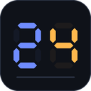

# Team Tracker Lite

     

One lightweight sports sensor: pick any team from a menu and switch whenever you like.

## Features

- Any team from ESPN's leagues, chosen in the sidebar panel
- One sensor (`sensor.team_tracker`) with game state, score, teams and colors
- Live game: follow any game that's on right now
- Optional calendar feed on port 8100 for your phone
- **Score lights**: flash lights in the team's colors when they score

## What you need

- Home Assistant OS or Supervised (add-ons need the Supervisor)
- MQTT (Mosquitto add-on or your own broker)

## Install

1. Click the button above, or go to **Settings → Add-ons → Add-on Store → ⋮ → Repositories** and add `https://github.com/jonathangibson98/pi-custom-features`.
2. Find **Team Tracker Lite** in the store and click **Install**.
3. Check the **Configuration** tab, then **Start**. Turn on **Show in sidebar** to open it from the sidebar.

## Documentation

- [Full documentation](DOCS.md), also on the add-on's **Documentation** tab
- [Changelog](CHANGELOG.md)
- [All add-ons in this repository](../README.md)
